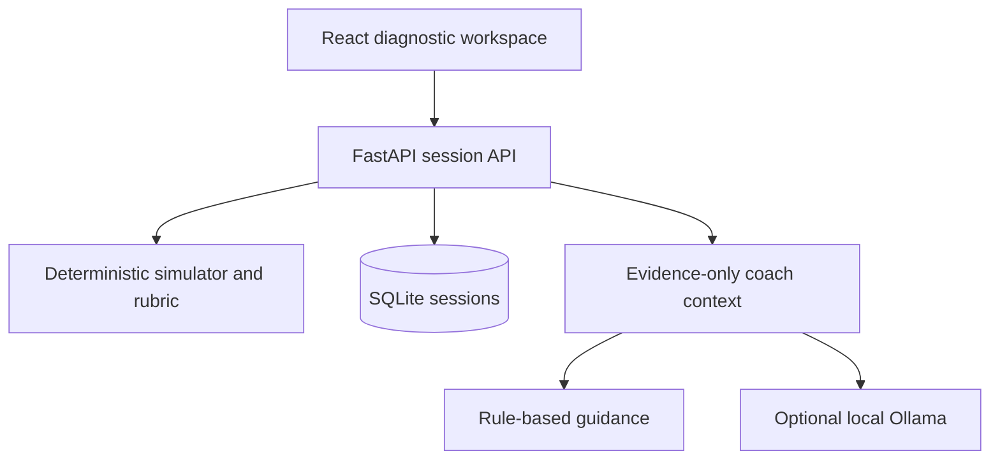

# FaultLab

**Learn practical skills by diagnosing failures.** A working hackathon prototype by **NOVA SPARKZ** for education and skill development under AI and emerging technologies.

A connected temperature display freezes. Is the problem in the sensor, firmware or communication link? Learners change the input, predict measurements, collect evidence, explain a diagnosis, apply a repair and prove that the system recovered.

## What works

- **Three hidden fault families:** stuck sensor output, stale firmware sample and dropped communication updates.
- **Deterministic simulation:** a first-order thermal model, sample provenance, packet counts and logical simulation time. The backend controls readings and the answer key.
- **Five diagnostic tools:** raw sensor, controller, communication, dashboard and physical connections.
- **Evidence before answers:** predictions are recorded before tests; a diagnosis must cite at least two real evidence records.
- **Practice and assessment:** practice offers coaching and retries; assessment varies starting temperature and response time, disables coaching and permits one diagnosis and one repair.
- **Recovery verification:** the display must follow two new temperatures after the repair; a matching value at one point is insufficient.
- **Reports and replay:** transparent workflow rubric, recorded reasoning, event replay, printable report and JSON export.
- **Persistence:** SQLite holds sessions; opaque session access keys remain in the learner's browser. Refreshing the page preserves cases.
- **Optional local AI:** Ollama provides evidence-grounded conversational hints. Without Ollama, a clearly labelled rule-based coach remains available.

## Run on Windows

Prerequisites: **Python 3.11 or newer** and **Node.js 22 or newer** with npm. Python 3.13 is supported by the source configuration; this build was tested with Python 3.12.

Extract the project, then double-click **`START_FAULTLAB.cmd`**. It creates the virtual environment, installs dependencies, builds the frontend and starts the app. Open **http://127.0.0.1:8000**. Keep the terminal open; press Ctrl+C to stop.

Manual commands in PowerShell:

```powershell
py -3 -m venv .venv
.\.venv\Scripts\python.exe -m pip install -r requirements.txt
npm ci
npm run build
npm run dev
```

## Run on macOS / Linux

```bash
python3 -m venv .venv
.venv/bin/python -m pip install -r requirements.txt
npm ci
npm run build
npm run dev
```

Open http://127.0.0.1:8000. The app serves the compiled frontend and API from one FastAPI process. Rebuild after frontend edits and restart after backend edits.

The downloadable ZIP also includes a prebuilt `dist/` folder. To run that build without Node, install the Python requirements and run `.venv/bin/python -m uvicorn backend.app:app --host 127.0.0.1 --port 8000` (on Windows use `.\.venv\Scripts\python.exe`). Set environment variables in your shell for AI in this mode; `.env` loading is provided by `npm run dev`.

## Enable your local Ollama model

Ollama is optional. Start Ollama and ensure your local `llama3:latest` model is available. Copy `.env.example` to `.env` in the project root and set:

```dotenv
FAULTLAB_OLLAMA_ENABLED=1
OLLAMA_BASE_URL=http://127.0.0.1:11434
OLLAMA_MODEL=llama3:latest
```

Restart with `npm run dev`. The server calls Ollama's `/api/chat` endpoint. The model receives the learner's question, predictions and observed readings, but not the injected fault key. It cannot change the simulator or assign scores. If the model is unavailable or returns malformed output, the UI labels the fallback as guided feedback. An AI answer can still be wrong; learners must check it against evidence.

## Five-minute demonstration

1. Start a practice case and apply a chamber temperature at least 5°C above the starting value.
2. Predict and measure the raw sensor, then the controller. Inspect communication if both respond.
3. Select two or more informative evidence records and submit a diagnosis with your explanation.
4. Apply the matching repair and run the two-temperature recovery check.
5. Review the actual fault, rubric and event replay. Start an independent assessment to test transfer.

See [the demo guide](docs/DEMO.md) for expected observations and a presentation script.

## Test and build

Install development dependencies with your virtual environment's Python:

```bash
.venv/bin/python -m pip install -r requirements-dev.txt
npm test
npm run build
```

On Windows replace the Python path with `.\.venv\Scripts\python.exe`. `npm test` selects the correct platform-specific interpreter automatically. GitHub Actions runs the tests and frontend build.

The suite covers correct and incorrect repairs, all fault families, reproducibility, hidden-answer protection, forged evidence, assessment restrictions, session persistence, input rejection and the Ollama request/fallback contract. Live Ollama inference and browser layout have separate verification requirements; see [validation notes](docs/VALIDATION.md).

## Architecture



| Path | Responsibility |
| --- | --- |
| `frontend/src/` | Accessible forms, lab workspace, charts, reports and replay |
| `backend/engine.py` | Thermal model, fault behavior, observations and verification |
| `backend/coach.py` | Optional model integration and deterministic fallback |
| `backend/storage.py` | Transactional SQLite state and hashed session capabilities |
| `backend/app.py` | Validated API routes and compiled frontend delivery |
| `tests/` | Simulation and API integration tests |

Interactive API documentation is available at `/docs` while the app runs. Session routes require the `X-Session-Key` returned when a session is created. The API rejects client-supplied fault and seed fields.

## Scope and limitations

This is a local, single-institution demonstration, not a production classroom service. It has no enrollment, teacher authentication, rate limiting, remote backup or cross-device account sync. Anyone with a session key can access that case. Clearing browser storage loses local access to saved cases. Do not enter personal or sensitive learner information. Use localhost for demonstrations; add deployment authentication, HTTPS, request limits and access controls before internet hosting.

The thermal model is a simplified teaching model, not a calibrated hardware twin. Assessment generates new parameters from the same three fault families; it does not prove transfer to unseen equipment. Scores measure explicit workflow rules, not validated competence or the semantic quality of reasoning. Instructor review is required. No GIS feature is claimed in this prototype.

## Team

| Role | Name |
| --- | --- |
| Team | NOVA SPARKZ |
| Team lead | MITESH KUMAAR S |
| Member | MOGHIT PM |
| Member | DILLI BASKARAN K |
| Team ID | HSC\|TN\|02631 |

Prepared for the MY Bharat government hackathon. Independent team prototype; no government endorsement is implied.

## Technical references

- [Ollama API documentation](https://github.com/ollama/ollama/blob/main/docs/api.md)
- [FastAPI testing](https://fastapi.tiangolo.com/tutorial/testing/)
- [FastAPI static files](https://fastapi.tiangolo.com/tutorial/static-files/)
